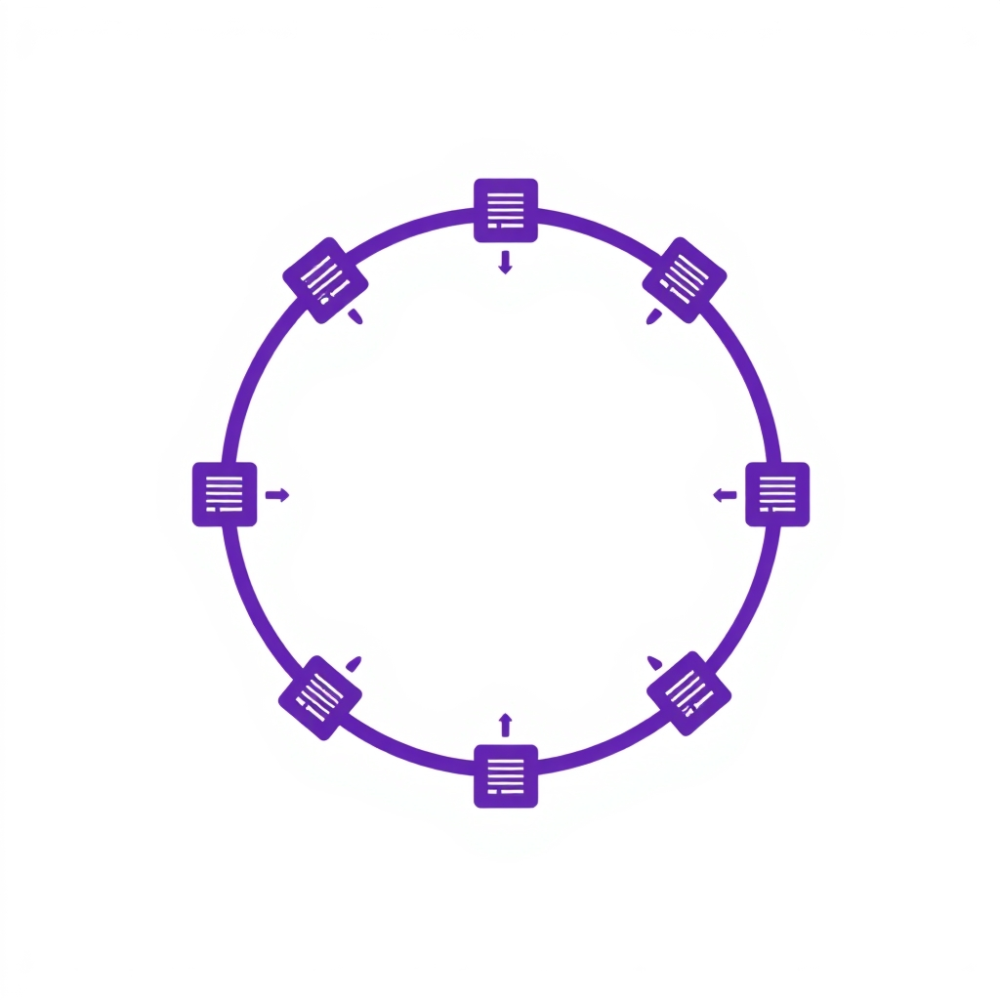

캐시 서버 4대를 운영하다가 트래픽이 늘어 1대를 추가했다. 그런데 서버를 늘린 직후 캐시 적중률이 바닥으로 떨어지고, 캐시 대신 DB로 요청이 쏟아져 오히려 서비스가 느려진다. 원인은 "키를 어느 서버에 둘지" 정하는 방식에 있다. 이 글은 흔히 쓰는 `hash(key) % 서버 수` 방식이 왜 서버 수가 바뀔 때 무너지는지, 이를 해결한 **일관성 해싱(consistent hashing — 서버 수가 바뀌어도 대부분의 키가 원래 서버에 그대로 남도록 배치하는 해싱 방식)**이 어떻게 동작하는지, 그리고 실전에서 꼭 함께 쓰는 **가상 노드**까지 차례로 본다.

<p style="font-size:13px;color:#5f5a68;background:#faf8fc;border-left:3px solid #b9a9cc;padding:8px 12px;border-radius:6px;margin:16px 0;">📝 이 글에 나오는 서버 구성·키·수치는 실제 겪은 장애가 아니라, <b>개념을 쉽게 보여주기 위해 지어낸 예시</b>입니다. (단, 시뮬레이션 출력은 글 속 코드를 직접 실행한 결과입니다.)</p>

<figure style="margin:22px 0;text-align:center;">

<figcaption style="font-size:12px;color:#5f5a68;margin-top:8px;">서버를 원형 고리 위에 올려 두고, 각 키는 고리를 따라 시계방향으로 걷다 처음 만나는 서버에 맡긴다. 이게 일관성 해싱의 전부다.</figcaption>
</figure>

## 먼저, 키를 서버에 나누는 가장 단순한 방법

**무엇인가.** 데이터가 많아지면 서버 한 대에 다 담을 수 없다. 그래서 여러 서버에 나눠 담는데, 이때 "키 `user:42`는 몇 번 서버에 있지?"를 매번 빠르게 계산할 수 있어야 한다. 가장 흔한 방법이 **모듈러 해싱(modular hashing)**이다.

`서버 번호 = hash(key) % 서버 수`

여기서 **해시 함수(hash function)**는 아무 문자열이나 넣으면 고정된 범위의 숫자로 바꿔 주는 함수다. 같은 입력엔 항상 같은 숫자가 나오고, 입력이 조금만 달라도 숫자는 크게 달라진다. 그 숫자를 서버 수로 나눈 나머지(`%`)가 서버 번호가 된다.

**왜 쓰나.** 계산이 한 줄이고, 서버별로 키가 거의 고르게 나뉜다. 서버 수가 **고정**이라면 이걸로 충분하다.

## 문제 — 서버 수가 바뀌면 거의 모든 키가 이사한다

모듈러 해싱의 약점은 **나누는 수(서버 수)가 바뀌면 나머지가 전부 다시 계산된다**는 점이다. 서버를 4대에서 5대로 늘리면, `hash % 4`와 `hash % 5`가 우연히 같은 키만 제자리에 남는다.

<!-- diagram: modulo-rehash -->
<figure style="margin:22px 0;padding:16px;background:#faf8fc;border:1px solid #e4e0ec;border-radius:12px;max-width:470px;">
<svg style="width:100%;height:auto;display:block;" viewBox="0 0 320 210" role="img" aria-label="키 8개의 해시값과, 서버 4대일 때(해시 나머지 4)와 5대일 때(해시 나머지 5)의 배정 서버를 비교한 표. 8개 중 2개만 같은 서버에 남고 6개는 다른 서버로 옮겨진다.">
<text x="160" y="14" font-size="9" fill="#1a1720" font-weight="700" text-anchor="middle">서버 4대 → 5대: 배정이 어떻게 바뀌나</text>
<g font-size="8" fill="#5F0080" font-weight="700" text-anchor="middle">
<text x="40" y="34">키</text><text x="100" y="34">해시값</text><text x="160" y="34">%4 (4대)</text><text x="220" y="34">%5 (5대)</text><text x="280" y="34">결과</text>
</g>
<line x1="10" y1="40" x2="310" y2="40" stroke="#b9a9cc"/>
<g font-size="8" fill="#1a1720" text-anchor="middle">
<text x="40" y="54">k1</text><text x="100" y="54">37</text><text x="160" y="54">1번</text><text x="220" y="54">2번</text>
<text x="40" y="72">k2</text><text x="100" y="72">52</text><text x="160" y="72">0번</text><text x="220" y="72">2번</text>
<text x="40" y="90">k3</text><text x="100" y="90">81</text><text x="160" y="90">1번</text><text x="220" y="90">1번</text>
<text x="40" y="108">k4</text><text x="100" y="108">64</text><text x="160" y="108">0번</text><text x="220" y="108">4번</text>
<text x="40" y="126">k5</text><text x="100" y="126">99</text><text x="160" y="126">3번</text><text x="220" y="126">4번</text>
<text x="40" y="144">k6</text><text x="100" y="144">120</text><text x="160" y="144">0번</text><text x="220" y="144">0번</text>
<text x="40" y="162">k7</text><text x="100" y="162">147</text><text x="160" y="162">3번</text><text x="220" y="162">2번</text>
<text x="40" y="180">k8</text><text x="100" y="180">158</text><text x="160" y="180">2번</text><text x="220" y="180">3번</text>
</g>
<g font-size="8" font-weight="700" text-anchor="middle">
<text x="280" y="54" fill="#b23a00">이동</text>
<text x="280" y="72" fill="#b23a00">이동</text>
<text x="280" y="90" fill="#1f7a4d">유지</text>
<text x="280" y="108" fill="#b23a00">이동</text>
<text x="280" y="126" fill="#b23a00">이동</text>
<text x="280" y="144" fill="#1f7a4d">유지</text>
<text x="280" y="162" fill="#b23a00">이동</text>
<text x="280" y="180" fill="#b23a00">이동</text>
</g>
<line x1="10" y1="188" x2="310" y2="188" stroke="#e4e0ec"/>
<text x="160" y="202" font-size="8" fill="#b23a00" font-weight="700" text-anchor="middle">서버 1대 추가했을 뿐인데 8개 중 6개가 이사</text>
</svg>
<figcaption style="font-size:12px;color:#5f5a68;margin-top:8px;">나누는 수가 4에서 5로 바뀌면 나머지가 대부분 달라진다. 해시값이 고르게 퍼져 있다면 4→5에서 제자리에 남는 키는 20개 중 4개꼴(20%)뿐이다.</figcaption>
</figure>

**왜 문제인가.** 키가 다른 서버로 옮겨 간다는 건 곧 이런 뜻이다.

- **캐시라면**: 새로 배정된 서버엔 그 키가 없다. 거의 모든 요청이 **캐시 미스(cache miss — 캐시에서 못 찾음)**가 되고, 그 요청이 한꺼번에 DB로 몰린다. 서론의 장면이 바로 이것이다.
- **저장소라면**: 데이터를 실제로 옮겨야 한다. 전체 데이터의 80%를 네트워크로 복사하는 동안 서비스가 무거워진다.

서버는 늘 바뀐다. 트래픽이 늘어 추가하고, 장애로 빠지고, 교체된다. 서버 한 대가 바뀔 때마다 전체가 흔들리는 구조는 확장에 쓸 수 없다.

## 일관성 해싱 — 서버와 키를 같은 원 위에 올린다

일관성 해싱은 1997년 Karger 등이 웹 캐시 분산을 위해 제안한 방법이다. 아이디어는 세 줄이다.

1. 해시값의 범위(예: 0 ~ 2³²−1)를 **끝과 처음이 이어진 원**으로 본다. 이 원을 **해시 링(hash ring)**이라 부른다.
2. **서버도** 해시해서(예: `hash("A")`) 링 위의 한 점에 올린다.
3. **키도** 해시해서 링 위에 올린 뒤, 그 자리에서 **시계방향으로 걷다가 처음 만나는 서버**에 맡긴다.

핵심은 2번이다. 모듈러 해싱에선 서버 번호가 "서버 수"라는 전체 값에 묶여 있었다. 일관성 해싱에선 각 서버가 **자기 위치 하나**만 갖는다. 그래서 서버가 하나 늘거나 줄어도 **그 서버 주변 구간만** 영향을 받는다.

<!-- diagram: hash-ring -->
<figure style="margin:22px 0;padding:16px;background:#faf8fc;border:1px solid #e4e0ec;border-radius:12px;max-width:470px;">
<svg style="width:100%;height:auto;display:block;" viewBox="0 0 320 215" role="img" aria-label="해시 링 위에 서버 A, B, C, D가 놓여 있고, 키 k1부터 k4가 시계방향으로 처음 만나는 서버에 배정된다. 새 서버 E를 A와 B 사이에 추가하면, A부터 E까지 구간에 있던 키 k1만 B에서 E로 옮겨지고 나머지 키는 그대로다.">
<circle cx="120" cy="110" r="70" fill="none" stroke="#b9a9cc" stroke-width="3"/>
<path d="M143.9 44.2 A70 70 0 0 1 183.4 80.4" fill="none" stroke="#b23a00" stroke-width="5" stroke-linecap="round"/>
<g fill="#5F0080">
<circle cx="143.9" cy="44.2" r="7"/><circle cx="185.8" cy="133.9" r="7"/><circle cx="96.1" cy="175.8" r="7"/><circle cx="54.2" cy="86.1" r="7"/>
</g>
<circle cx="183.4" cy="80.4" r="7" fill="#fff" stroke="#b23a00" stroke-width="2"/>
<g font-size="9" font-weight="700" fill="#5F0080" text-anchor="middle">
<text x="149" y="30">A</text><text x="202" y="143">B</text><text x="90" y="198">C</text><text x="38" y="84">D</text>
</g>
<text x="202" y="76" font-size="9" font-weight="700" fill="#b23a00" text-anchor="middle">E</text>
<g fill="#7d5a9e">
<rect x="166" y="57" width="7" height="7" rx="1"/><rect x="186.5" y="106.5" width="7" height="7" rx="1"/><rect x="140.4" y="172.3" width="7" height="7" rx="1"/><rect x="92.6" y="40.7" width="7" height="7" rx="1"/>
</g>
<g font-size="7" fill="#1a1720" text-anchor="middle">
<text x="157" y="76">k1</text><text x="174" y="113">k2</text><text x="138" y="164">k3</text><text x="103" y="62">k4</text>
</g>
<text x="120" y="106" font-size="8" fill="#5f5a68" text-anchor="middle">시계방향 ↻</text>
<text x="120" y="118" font-size="7" fill="#5f5a68" text-anchor="middle">처음 만나는 서버</text>
<g font-size="7.5" fill="#1a1720">
<text x="222" y="30" font-weight="700" fill="#5F0080">E 추가 전 → 후</text>
<text x="222" y="46">k4 → A</text><text x="268" y="46" fill="#1f7a4d">유지</text>
<text x="222" y="60">k1 → B → <tspan fill="#b23a00" font-weight="700">E</tspan></text><text x="282" y="60" fill="#b23a00" font-weight="700">이동</text>
<text x="222" y="74">k2 → B</text><text x="268" y="74" fill="#1f7a4d">유지</text>
<text x="222" y="88">k3 → C</text><text x="268" y="88" fill="#1f7a4d">유지</text>
</g>
<rect x="222" y="108" width="12" height="4" rx="2" fill="#b23a00"/>
<text x="238" y="112" font-size="7" fill="#5f5a68">A~E 구간만 영향</text>
<circle cx="228" cy="126" r="4" fill="#5F0080"/>
<text x="238" y="129" font-size="7" fill="#5f5a68">기존 서버</text>
<rect x="224.5" y="139.5" width="7" height="7" rx="1" fill="#7d5a9e"/>
<text x="238" y="146" font-size="7" fill="#5f5a68">키</text>
</svg>
<figcaption style="font-size:12px;color:#5f5a68;margin-top:8px;">새 서버 E는 A와 B 사이에 자리 잡는다. 원래 B로 가던 키 중 A~E 구간(주황)에 있던 것만 E로 옮겨 가고, 다른 키는 전혀 움직이지 않는다.</figcaption>
</figure>

**서버를 추가하면.** E가 A와 B 사이에 들어오면, A~E 구간의 키만 B에서 E로 옮겨 간다. C·D 쪽 키는 아무 일도 없다.

**서버를 빼면.** 반대로 B가 죽으면, B가 맡던 키는 시계방향 다음 서버(C)로 넘어간다. 역시 B 구간만 움직인다.

**얼마나 움직이나.** 키가 고르게 퍼져 있고 서버도 고르게 퍼져 있다면, 서버 N대에서 1대를 추가할 때 옮겨 가는 키는 대략 **전체의 1/(N+1)**이다. 4대에서 5대로 늘리면 약 20%다. 새 서버가 자기 몫(1/5)만큼만 가져가는 셈이고, 이론상 이보다 덜 옮길 수는 없다. 모듈러 해싱의 80%와 비교하면 네 배 차이다.

## 남은 문제 — 서버가 링 위에 고르게 놓이지 않는다

위 설명엔 숨은 가정이 있다. "서버도 링 위에 고르게 퍼져 있다면." 실제로는 서버 위치도 해시로 정하기 때문에 **운에 맡겨진다**. 서버가 4~5대뿐이면 어떤 서버는 링의 넓은 구간을, 어떤 서버는 손톱만 한 구간을 맡기 쉽다. 맡은 구간이 넓으면 키도 많이 받으니, 부하가 크게 쏠린다.

또 하나. 서버 B가 빠지면 B의 키 **전부가 바로 옆 C 한 대**로 넘어간다. C는 갑자기 두 배 가까운 부하를 받는다. 장애가 옆 서버로 번지기 쉬운 구조다.

## 해결 — 가상 노드(virtual node)

**무엇인가.** 서버 하나를 링 위에 **한 점이 아니라 여러 점**으로 올린다. 서버 A를 `hash("A#0")`, `hash("A#1")`, …, `hash("A#99")` 이렇게 100군데에 놓는 식이다. 이 각각의 점을 **가상 노드(virtual node, vnode)**라 부른다. 키는 여전히 시계방향 첫 점을 찾고, 그 점이 어느 서버의 것인지만 보면 된다.

**왜 효과가 있나.**

- **고르게 나뉜다.** 서버마다 작은 구간 100개를 맡게 된다. 몇 개는 넓고 몇 개는 좁아도, 100개를 합치면 운이 평균에 가까워진다. 동전을 4번 던지면 앞면 비율이 들쭉날쭉하지만 400번 던지면 50%에 가까워지는 것과 같은 원리다.
- **빠질 때 흩어진다.** 서버 B가 빠지면 B의 가상 노드 100개가 각자 다음 점으로 넘어간다. 그 다음 점들은 A·C·D에 골고루 섞여 있으니, B의 부하가 **한 서버에 몰리지 않고 나머지 서버 전체로 흩어진다**.
- **성능 차이를 반영할 수 있다.** 사양이 두 배인 서버엔 가상 노드를 두 배로 주면 키도 두 배쯤 받는다.

**대가.** 링에 올라가는 점이 "서버 수 × 가상 노드 수"로 늘어 메모리를 더 쓰고, 키 하나를 찾을 때 탐색할 점도 많아진다. 다만 점들을 정렬해 두고 **이진 탐색(binary search — 정렬된 목록을 절반씩 좁혀 찾는 방법)**을 쓰면 점이 1만 개여도 비교 14번 안팎이면 찾는다. 대개 문제가 되지 않는 수준이다.

## 상세 예시 — 10만 개 키로 직접 재 보기

말로 한 걸 직접 돌려 보자. 키 `user:0` ~ `user:99999` 10만 개를 서버 A·B·C·D 4대에 나눈 뒤, 서버 E를 추가한다. 세 방식을 비교한다.

- 모듈러 해싱 (`hash % 서버 수`)
- 일관성 해싱, 가상 노드 1개 (서버당 링 위 점 1개)
- 일관성 해싱, 가상 노드 100개

이 코드가 하는 일: 모듈러 해싱과 해시 링을 구현하고, 서버를 4대에서 5대로 늘렸을 때 배정이 바뀐 키의 비율과 5대 사이의 키 분포를 출력한다.

```python
import hashlib, bisect

def h(s):
    # 문자열 → 0 ~ 2^32-1 사이 정수 (MD5 앞 4바이트)
    return int.from_bytes(hashlib.md5(s.encode()).digest()[:4], "big")

class ModHash:
    def __init__(self, nodes): self.nodes = list(nodes)
    def get(self, key): return self.nodes[h(key) % len(self.nodes)]

class HashRing:
    def __init__(self, nodes, vnodes=1):
        self.vnodes, self.ring = vnodes, []          # [(위치, 서버)] 정렬 유지
        for n in nodes: self.add(n)
    def add(self, node):
        for i in range(self.vnodes):
            bisect.insort(self.ring, (h(f"{node}#{i}"), node))
    def get(self, key):
        i = bisect.bisect(self.ring, (h(key), ""))   # 시계방향 첫 지점
        return self.ring[i % len(self.ring)][1]      # 끝을 넘으면 0번으로(원형)

keys  = [f"user:{i}" for i in range(100_000)]
old   = ["A", "B", "C", "D"]
new   = old + ["E"]

def moved(before, after):
    return sum(before.get(k) != after.get(k) for k in keys) / len(keys)

def load(r, nodes):
    cnt = {n: 0 for n in nodes}
    for k in keys: cnt[r.get(k)] += 1
    return {n: f"{c/len(keys):.1%}" for n, c in cnt.items()}

print(f"[모듈러]        서버 4→5 이동 비율: {moved(ModHash(old), ModHash(new)):.1%}")
for v in (1, 100):
    a, b = HashRing(old, v), HashRing(new, v)
    print(f"[링 vnode={v:<3}] 서버 4→5 이동 비율: {moved(a, b):.1%} | 5대 분포: {load(b, new)}")
```

`HashRing.get`의 두 줄이 링의 핵심이다. `bisect.bisect`는 정렬된 목록에서 "키 위치보다 큰 첫 점"을 이진 탐색으로 찾는다. 이게 "시계방향으로 처음 만나는 서버"다. 링 끝을 넘어가면 `% len(self.ring)`으로 0번 점으로 돌아온다. 원이라서다.

실행 결과:

```text
[모듈러]        서버 4→5 이동 비율: 79.7%
[링 vnode=1  ] 서버 4→5 이동 비율: 17.3% | 5대 분포: {'A': '3.1%', 'B': '1.3%', 'C': '40.2%', 'D': '38.1%', 'E': '17.3%'}
[링 vnode=100] 서버 4→5 이동 비율: 19.6% | 5대 분포: {'A': '20.6%', 'B': '22.5%', 'C': '19.5%', 'D': '17.7%', 'E': '19.6%'}
```

<!-- diagram: vnode-balance -->
<figure style="margin:22px 0;padding:16px;background:#faf8fc;border:1px solid #e4e0ec;border-radius:12px;max-width:470px;">
<svg style="width:100%;height:auto;display:block;" viewBox="0 0 320 202" role="img" aria-label="서버 5대의 키 분포 막대그래프. 가상 노드 1개일 때는 A 3.1%, B 1.3%, C 40.2%, D 38.1%, E 17.3%로 크게 쏠린다. 가상 노드 100개일 때는 A 20.6%, B 22.5%, C 19.5%, D 17.7%, E 19.6%로 이상값 20% 근처에 고르게 모인다.">
<text x="87" y="14" font-size="9" fill="#b23a00" font-weight="700" text-anchor="middle">가상 노드 1개</text>
<text x="242" y="14" font-size="9" fill="#1f7a4d" font-weight="700" text-anchor="middle">가상 노드 100개</text>
<line x1="20" y1="95.6" x2="155" y2="95.6" stroke="#5f5a68" stroke-dasharray="3 2"/>
<line x1="175" y1="95.6" x2="310" y2="95.6" stroke="#5f5a68" stroke-dasharray="3 2"/>
<g fill="#b23a00">
<rect x="26" y="133.1" width="18" height="6.9"/><rect x="52" y="137.1" width="18" height="2.9"/><rect x="78" y="50.7" width="18" height="89.3"/><rect x="104" y="55.3" width="18" height="84.7"/><rect x="130" y="101.6" width="18" height="38.4"/>
</g>
<g fill="#1f7a4d">
<rect x="181" y="94.2" width="18" height="45.8"/><rect x="207" y="90" width="18" height="50"/><rect x="233" y="96.7" width="18" height="43.3"/><rect x="259" y="100.7" width="18" height="39.3"/><rect x="285" y="96.4" width="18" height="43.6"/>
</g>
<line x1="20" y1="140" x2="155" y2="140" stroke="#1a1720"/>
<line x1="175" y1="140" x2="310" y2="140" stroke="#1a1720"/>
<g font-size="8" fill="#5f5a68" text-anchor="middle">
<text x="35" y="152">A</text><text x="61" y="152">B</text><text x="87" y="152">C</text><text x="113" y="152">D</text><text x="139" y="152">E</text>
<text x="190" y="152">A</text><text x="216" y="152">B</text><text x="242" y="152">C</text><text x="268" y="152">D</text><text x="294" y="152">E</text>
</g>
<g font-size="6.5" fill="#1a1720" text-anchor="middle">
<text x="35" y="163">3.1</text><text x="61" y="163">1.3</text><text x="87" y="163">40.2</text><text x="113" y="163">38.1</text><text x="139" y="163">17.3</text>
<text x="190" y="163">20.6</text><text x="216" y="163">22.5</text><text x="242" y="163">19.5</text><text x="268" y="163">17.7</text><text x="294" y="163">19.6</text>
</g>
<text x="87" y="180" font-size="7" fill="#b23a00" text-anchor="middle">최대/최소 ≈ 31배</text>
<text x="242" y="180" font-size="7" fill="#1f7a4d" text-anchor="middle">최대/최소 ≈ 1.3배</text>
<text x="160" y="196" font-size="6.5" fill="#5f5a68" text-anchor="middle">(단위: 전체 키 10만 개 중 비율 %, 점선 = 이상값 20%, 위 코드 실행 결과)</text>
</svg>
<figcaption style="font-size:12px;color:#5f5a68;margin-top:8px;">같은 서버 5대, 같은 키 10만 개인데 가상 노드 수에 따라 분포가 완전히 달라진다. 점선이 5대에 똑같이 나눴을 때의 20%다.</figcaption>
</figure>

**읽는 법.**

- **모듈러 해싱**은 서버 1대를 추가했을 뿐인데 **79.7%**가 다른 서버로 옮겨 갔다. 앞에서 계산한 이론값 80%와 거의 같다. 캐시였다면 키 10개 중 8개가 한순간에 캐시 미스가 된다.
- **링 + 가상 노드 1개**는 **17.3%**만 옮겨 갔다. 이동량은 확실히 줄었다. 그런데 분포를 보자. C가 40.2%, D가 38.1%를 맡는 동안 B는 1.3%뿐이다. 가장 바쁜 서버(C)가 가장 한가한 서버(B)의 약 31배(40.2 ÷ 1.3) 일을 한다. 서버 위치가 운에 맡겨진 결과다. 이동량이 17.3%로 이론값 20%보다 적은 것도 같은 이유다. E가 우연히 좁은 구간을 차지해 자기 몫(20%)보다 적게 가져왔다.
- **링 + 가상 노드 100개**는 **19.6%**가 옮겨 갔다. 이론상 최소인 20%(새 서버의 몫)에 거의 붙었다. 분포도 17.7% ~ 22.5%로 다섯 서버가 고르게 나눠 맡았다(최대/최소 22.5 ÷ 17.7 ≈ 1.3배).

정리하면, **링은 "덜 옮기기"를, 가상 노드는 "고르게 나누기"를** 해결한다. 실전에서 둘을 함께 쓰는 이유다.

| 방식 | 서버 4→5 이동 비율 | 5대 분포(최소~최대) | 서버 1대 장애 시 |
|---|---|---|---|
| 모듈러 해싱 | 79.7% | 고름 | 서버 수가 바뀌어 대부분 재배치 |
| 링 (가상 노드 1개) | 17.3% | 1.3% ~ 40.2% | 옆 서버 1대에 몰림 |
| 링 (가상 노드 100개) | 19.6% | 17.7% ~ 22.5% | 남은 서버 전체로 흩어짐 |

## 실제로 어디서 쓰나

- **Amazon Dynamo**: 2007년 Dynamo 논문이 일관성 해싱 + 가상 노드로 데이터를 나누고, 링에서 시계방향 다음 N개 노드에 복제본을 두는 구조를 소개했다. 이후 많은 분산 저장소가 이 설계를 참고했다.
- **Apache Cassandra**: 노드마다 링 위 토큰(token — 링 위 위치)을 여러 개 갖는 방식(설정 `num_tokens`)으로 같은 아이디어를 쓴다.
- **memcached 클라이언트**: 서버 쪽이 아니라 **클라이언트 라이브러리**가 링을 들고 "이 키는 어느 캐시 서버로 보낼지"를 계산한다. ketama가 널리 알려진 구현이다.

반대로 헷갈리기 쉬운 예도 있다. **Redis Cluster는 일관성 해싱을 쓰지 않는다.** 키를 `CRC16(key) % 16384`로 계산해 고정된 **16384개의 해시 슬롯(hash slot)** 중 하나에 넣고, 슬롯을 노드에 나눠 준다. 노드가 추가되면 키가 아니라 **슬롯 단위로** 옮긴다. 나누는 수(16384)가 서버 수와 무관하게 고정이라 모듈러 해싱의 문제를 피하는, 다른 갈래의 해법이다.

이 밖에도 같은 문제를 푸는 방식으로, 키마다 모든 서버와 점수를 매겨 가장 높은 서버를 고르는 **랑데부 해싱(rendezvous hashing, HRW)**, 링 없이 계산만으로 서버 번호를 구하는 **점프 일관성 해싱(jump consistent hash)** 등이 있다. 상황에 따라 메모리·계산량·서버 제거 지원 여부가 달라 골라 쓴다.

## 한 줄 교훈

`hash % 서버 수`는 서버 수가 바뀌는 순간 거의 모든 키를 옮긴다. 서버를 **원 위의 점**으로 바꾸면 바뀐 서버 주변만 움직이고, 그 점을 **서버당 여러 개(가상 노드)**로 늘리면 부하까지 고르게 나뉜다.
