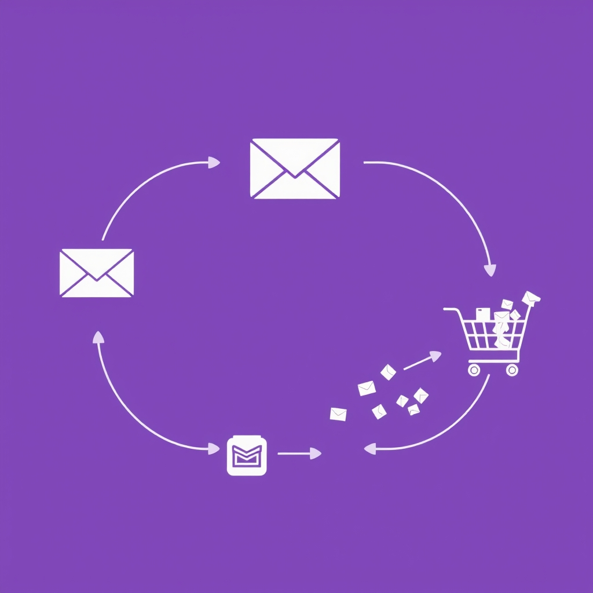

서비스끼리, 또는 앱과 서버가 데이터를 주고받으려면 "어떤 주소로, 어떤 모양의 요청을 보내면, 어떤 모양의 답이 온다"는 약속이 필요하다. 이 약속을 **API(Application Programming Interface — 프로그램끼리 대화하는 규칙)**라 부른다. API를 설계하는 대표적인 스타일이 셋 있다. 웹의 기본 문법을 그대로 쓰는 **REST**, 구글이 만든 고속 원격 호출 방식 **gRPC**, 페이스북이 만든 "필요한 것만 골라 묻는" 질의 언어 **GraphQL**이다. 이 글은 셋이 각각 무엇이고 왜 생겼는지 본 뒤, "주문 상세 화면 하나"를 세 방식으로 만들어 요청 수와 바이트가 어떻게 달라지는지 비교한다.

<p style="font-size:13px;color:#5f5a68;background:#faf8fc;border-left:3px solid #b9a9cc;padding:8px 12px;border-radius:6px;margin:16px 0;">📝 이 글에 나오는 수치·엔드포인트·스키마는 실제 겪은 장애가 아니라, <b>개념을 쉽게 보여주기 위해 지어낸 예시</b>입니다. (단, Protocol Buffers 인코딩 바이트와 gRPC 메시지 프레임 형식은 공식 명세대로 계산했습니다.)</p>

<figure style="margin:22px 0;text-align:center;">

<figcaption style="font-size:12px;color:#5f5a68;margin-top:8px;">큰 봉투를 주고받는 REST, 작게 압축한 상자를 빠르게 보내는 gRPC, 필요한 조각만 골라 담는 GraphQL.</figcaption>
</figure>

## 예시 무대 — 주문 상세 화면

세 방식을 같은 문제로 비교하려고 무대를 하나 정한다. 쇼핑 앱의 **주문 상세 화면**이다. 이 화면에 필요한 건 딱 이것뿐이다.

- 주문 번호, 주문 상태
- 주문한 사람 **이름**
- 담긴 상품 3개의 **상품명**

서버에는 주문(order), 회원(user), 상품(product) 데이터가 따로 저장돼 있다. 회원 데이터에는 이름 말고도 이메일·주소·가입일 등 20개 필드가, 상품 데이터에는 상품명 말고도 설명·이미지 목록·재고 등 30개 필드가 있다고 하자.

## REST — 웹의 문법으로 "자원"을 다루기

### 무엇인가

**REST(REpresentational State Transfer)**는 2000년 로이 필딩(Roy Fielding)이 박사 논문에서 정리한 설계 스타일이다. 프로토콜이나 라이브러리가 아니라 "이렇게 설계하자"는 원칙 묶음이다. 핵심은 세 가지다.

1. **자원(resource)을 URL로 이름 붙인다.** 주문 42번은 `/orders/42`, 회원 7번은 `/users/7`.
2. **할 일은 HTTP 메서드로 표현한다.** 조회는 `GET`, 생성은 `POST`, 전체 수정은 `PUT`, 삭제는 `DELETE`.
3. **결과는 HTTP 상태 코드로 알린다.** 성공 `200`, 생성됨 `201`, 없음 `404`, 서버 오류 `500`.

데이터 형식은 정해져 있지 않지만 사실상 **JSON(사람이 읽을 수 있는 텍스트 데이터 형식)**이 표준처럼 쓰인다.

### 왜 널리 쓰이나

HTTP를 그대로 쓰니 **이미 있는 웹 인프라가 전부 공짜로 따라온다.** 브라우저, `curl`, 프록시, CDN이 다 이해한다. 특히 **HTTP 캐시**가 강력하다. `GET /products/101` 응답에 `Cache-Control: max-age=60`을 붙이면, 브라우저나 CDN이 60초 동안 서버에 묻지 않고 저장해 둔 답을 쓴다. URL 하나가 자원 하나라서 "무엇을 캐시할지"가 명확하다.

### 약점 — 너무 많이 받거나, 너무 여러 번 묻거나

REST의 응답 모양은 **서버가 정한다.** 그래서 두 가지 문제가 생긴다.

- **오버페칭(over-fetching — 필요 이상으로 받기)**: 이름 하나가 필요한데 `GET /users/7`은 필드 20개를 다 준다.
- **언더페칭(under-fetching — 한 번에 다 못 받아 여러 번 묻기)**: 주문 응답엔 회원 ID와 상품 ID만 있다. 이름과 상품명을 얻으려면 요청을 더 보내야 한다.

주문 상세 화면을 REST로 그리면 이렇게 된다.

이 요청 목록이 하는 일: 화면 하나를 채우려고 주문 → 회원 → 상품 3개를 차례로 조회한다.
```http
GET /orders/42        → { "id": 42, "status": "SHIPPED", "userId": 7, "productIds": [101, 102, 103] }
GET /users/7          → { "id": 7, "name": "kim", "email": "...", "address": "...", ... 20개 필드 }
GET /products/101     → { "id": 101, "name": "사과", "description": "...", ... 30개 필드 }
GET /products/102     → ...
GET /products/103     → ...
```

요청 5번. 특히 주문 응답을 받아야 회원·상품 ID를 알 수 있으니 **최소 2번은 순서대로 기다려야 한다(왕복 2회)**. 모바일처럼 왕복 한 번이 100ms씩 걸리는 환경에서는 이 대기가 화면 속도를 그대로 깎는다. 물론 `GET /orders/42?expand=user,products` 같은 전용 엔드포인트를 만들어 풀 수 있지만, 화면이 바뀔 때마다 서버를 고쳐야 한다.

<!-- diagram: request-shapes -->
<figure style="margin:22px 0;padding:16px;background:#faf8fc;border:1px solid #e4e0ec;border-radius:12px;max-width:470px;">
<svg style="width:100%;height:auto;display:block;" viewBox="0 0 340 230" role="img" aria-label="주문 상세 화면을 세 방식으로 요청하는 모양 비교. REST는 클라이언트가 주문, 회원, 상품 세 개에 각각 요청을 보내 총 다섯 번, 왕복 두 단계가 필요하다. GraphQL은 /graphql 하나에 질의 한 번을 보내고 서버 안에서 리졸버들이 데이터를 모은다. gRPC는 정해진 메서드 GetOrderDetail을 한 번 호출하고 바이너리 응답을 받는다.">
<defs>
<marker id="rg-p" viewBox="0 0 10 10" refX="9" refY="5" markerWidth="5" markerHeight="5" orient="auto"><path d="M0,0 L10,5 L0,10 z" fill="#5F0080"/></marker>
<marker id="rg-s" viewBox="0 0 10 10" refX="9" refY="5" markerWidth="5" markerHeight="5" orient="auto"><path d="M0,0 L10,5 L0,10 z" fill="#7d5a9e"/></marker>
</defs>
<!-- REST -->
<text x="8" y="16" font-size="9" font-weight="700" fill="#1a1720">REST</text>
<text x="44" y="16" font-size="7" fill="#b23a00">요청 5번 · 왕복 2단계</text>
<rect x="8" y="26" width="46" height="62" rx="6" fill="#fff" stroke="#b9a9cc"/>
<text x="31" y="60" font-size="7.5" fill="#1a1720" text-anchor="middle">앱</text>
<rect x="130" y="24" width="80" height="13" rx="3" fill="#f4eff9" stroke="#7d5a9e" stroke-width="0.8"/>
<text x="170" y="33" font-size="6.5" fill="#1a1720" text-anchor="middle">① GET /orders/42</text>
<rect x="130" y="42" width="80" height="13" rx="3" fill="#f4eff9" stroke="#7d5a9e" stroke-width="0.8"/>
<text x="170" y="51" font-size="6.5" fill="#1a1720" text-anchor="middle">② GET /users/7</text>
<rect x="130" y="60" width="80" height="13" rx="3" fill="#f4eff9" stroke="#7d5a9e" stroke-width="0.8"/>
<text x="170" y="69" font-size="6.5" fill="#1a1720" text-anchor="middle">② GET /products/101</text>
<rect x="130" y="78" width="80" height="13" rx="3" fill="#f4eff9" stroke="#7d5a9e" stroke-width="0.8"/>
<text x="170" y="87" font-size="6.5" fill="#1a1720" text-anchor="middle">② …/102, …/103</text>
<line x1="56" y1="31" x2="128" y2="31" stroke="#5F0080" stroke-width="1" marker-end="url(#rg-p)"/>
<line x1="56" y1="49" x2="128" y2="49" stroke="#7d5a9e" stroke-width="1" marker-end="url(#rg-s)"/>
<line x1="56" y1="67" x2="128" y2="67" stroke="#7d5a9e" stroke-width="1" marker-end="url(#rg-s)"/>
<line x1="56" y1="85" x2="128" y2="85" stroke="#7d5a9e" stroke-width="1" marker-end="url(#rg-s)"/>
<text x="272" y="50" font-size="6.5" fill="#5f5a68" text-anchor="middle">① 응답을 받아야</text>
<text x="272" y="60" font-size="6.5" fill="#5f5a68" text-anchor="middle">② ID를 알 수 있음</text>
<text x="272" y="74" font-size="6.5" fill="#b23a00" text-anchor="middle">응답은 필드 전부</text>
<!-- GraphQL -->
<line x1="8" y1="104" x2="332" y2="104" stroke="#e4e0ec"/>
<text x="8" y="122" font-size="9" font-weight="700" fill="#1a1720">GraphQL</text>
<text x="62" y="122" font-size="7" fill="#1f7a4d">요청 1번 · 필요한 필드만</text>
<rect x="8" y="130" width="46" height="30" rx="6" fill="#fff" stroke="#b9a9cc"/>
<text x="31" y="148" font-size="7.5" fill="#1a1720" text-anchor="middle">앱</text>
<line x1="56" y1="145" x2="118" y2="145" stroke="#5F0080" stroke-width="1.2" marker-end="url(#rg-p)"/>
<text x="87" y="140" font-size="6" fill="#5F0080" text-anchor="middle">POST /graphql</text>
<rect x="120" y="128" width="90" height="34" rx="6" fill="#f4eff9" stroke="#5F0080"/>
<text x="165" y="142" font-size="7" fill="#1a1720" text-anchor="middle">GraphQL 서버</text>
<text x="165" y="153" font-size="6" fill="#5f5a68" text-anchor="middle">리졸버가 모아서 조립</text>
<line x1="212" y1="138" x2="244" y2="130" stroke="#7d5a9e" stroke-width="0.8" marker-end="url(#rg-s)"/>
<line x1="212" y1="145" x2="244" y2="145" stroke="#7d5a9e" stroke-width="0.8" marker-end="url(#rg-s)"/>
<line x1="212" y1="152" x2="244" y2="160" stroke="#7d5a9e" stroke-width="0.8" marker-end="url(#rg-s)"/>
<text x="248" y="132" font-size="6.5" fill="#1a1720">주문</text>
<text x="248" y="147" font-size="6.5" fill="#1a1720">회원</text>
<text x="248" y="162" font-size="6.5" fill="#1a1720">상품</text>
<!-- gRPC -->
<line x1="8" y1="174" x2="332" y2="174" stroke="#e4e0ec"/>
<text x="8" y="192" font-size="9" font-weight="700" fill="#1a1720">gRPC</text>
<text x="42" y="192" font-size="7" fill="#1f7a4d">메서드 호출 1번 · 바이너리</text>
<rect x="8" y="200" width="46" height="26" rx="6" fill="#fff" stroke="#b9a9cc"/>
<text x="31" y="216" font-size="7" fill="#1a1720" text-anchor="middle">서비스 A</text>
<line x1="56" y1="213" x2="118" y2="213" stroke="#5F0080" stroke-width="1.2" marker-end="url(#rg-p)"/>
<text x="87" y="208" font-size="5.6" fill="#5F0080" text-anchor="middle">GetOrderDetail()</text>
<rect x="120" y="200" width="90" height="26" rx="6" fill="#f4eff9" stroke="#5F0080"/>
<text x="165" y="216" font-size="7" fill="#1a1720" text-anchor="middle">서비스 B</text>
<text x="272" y="210" font-size="6.5" fill="#5f5a68" text-anchor="middle">.proto 계약대로</text>
<text x="272" y="220" font-size="6.5" fill="#5f5a68" text-anchor="middle">작은 바이트로 응답</text>
</svg>
<figcaption style="font-size:12px;color:#5f5a68;margin-top:8px;">같은 화면을 채우는 요청 모양. REST는 자원마다 묻고, GraphQL은 한 번에 골라 묻고, gRPC는 정해 둔 함수를 부른다.</figcaption>
</figure>

## GraphQL — 클라이언트가 응답 모양을 정한다

### 무엇인가

**GraphQL**은 2012년 페이스북이 모바일 앱용으로 만들어 2015년에 공개한 **API용 질의 언어(query language)**다. 서버는 "어떤 타입과 필드가 있는지"를 **스키마(schema — 데이터 구조 설계도)**로 공개하고, 클라이언트는 그 안에서 **필요한 필드만 골라** 질의를 보낸다. 보통 엔드포인트는 `/graphql` 하나뿐이다.

이 스키마가 하는 일: 주문·회원·상품 타입과, 주문을 ID로 찾는 진입점을 선언한다.
```graphql
type Order   { id: ID!, status: String!, user: User!, items: [Product!]! }
type User    { id: ID!, name: String!, email: String! }   # 실제로는 필드 20개
type Product { id: ID!, name: String!, description: String }  # 실제로는 필드 30개
type Query   { order(id: ID!): Order }
```

주문 상세 화면은 질의 하나로 끝난다.

이 질의가 하는 일: 주문 42번의 상태, 주문자 이름, 상품명만 한 번에 요청한다.
```graphql
query {
  order(id: 42) {
    status
    user { name }
    items { name }
  }
}
```

응답은 **질의와 똑같은 모양**으로 온다.

```json
{ "data": { "order": { "status": "SHIPPED",
  "user": { "name": "kim" },
  "items": [ { "name": "사과" }, { "name": "배" }, { "name": "귤" } ] } } }
```

### 왜 쓰나

- 오버페칭·언더페칭이 동시에 풀린다. 요청 1번, 필요한 필드만.
- 화면이 바뀌어도(예: 상품 이미지도 보여주기) **서버 수정 없이 질의만 고치면 된다.** 앱·웹·태블릿처럼 화면이 여러 개인 서비스에서 특히 편하다.
- 스키마가 곧 문서라, 도구가 자동완성·타입 검사를 해 준다.

### 대가

- **HTTP 캐시를 쓰기 어렵다.** 보통 모든 질의가 같은 URL에 `POST`로 가서 CDN이 "무엇을 캐시할지" 알 수 없다. 그래서 클라이언트 쪽 캐시(Apollo Client 등)나 미리 등록한 질의(persisted query)를 `GET`으로 보내는 식의 별도 장치가 필요하다.
- **서버 쪽 N+1 문제.** 서버는 필드마다 **리졸버(resolver — 그 필드 값을 가져오는 함수)**를 실행한다. 순진하게 짜면 상품 3개에 대해 상품 조회를 3번 따로 날린다(주문 100건이면 100번). 보통 **DataLoader(같은 순간에 들어온 조회를 모아 한 번에 처리하는 도구)**로 묶는다.
- **비싼 질의 방어.** 클라이언트가 응답 모양을 정하니, 깊이 10단 중첩 질의 같은 무거운 요청도 보낼 수 있다. 질의 깊이·복잡도 제한이 필요하다.
- **오류 표현이 다르다.** 질의 일부만 실패해도 응답에 `data`와 `errors` 배열이 함께 오고, HTTP 상태는 흔히 `200`이다. 상태 코드만 보는 모니터링으로는 실패를 놓칠 수 있다.

## gRPC — 원격 함수를 로컬 함수처럼 부른다

### 무엇인가

**gRPC**는 구글이 사내에서 쓰던 RPC 시스템을 바탕으로 2015년 공개한 프레임워크다. **RPC(Remote Procedure Call — 다른 서버에 있는 함수를 내 코드의 함수처럼 호출하는 방식)**라는 이름 그대로, "자원을 조회한다"가 아니라 **"함수를 부른다"**는 사고방식이다. 두 가지 기술 위에 서 있다.

1. **Protocol Buffers(protobuf)** — 데이터를 **바이너리(사람이 못 읽는 압축된 바이트)**로 바꾸는 직렬화(serialization — 메모리 속 객체를 전송 가능한 바이트로 바꾸는 것) 형식. `.proto` 파일에 메시지와 서비스를 정의하면 각 언어용 코드가 **자동 생성**된다.
2. **HTTP/2** — 연결 하나에서 여러 요청을 동시에 흘리는 **멀티플렉싱(multiplexing)**과 헤더 압축을 지원하는 HTTP 버전.

이 `.proto`가 하는 일: 회원 메시지 형식과, 주문 상세를 돌려주는 원격 함수의 시그니처를 정의한다.
```protobuf
syntax = "proto3";

message User {
  int32  id   = 1;   // 숫자 1, 2는 "필드 번호" — 이름 대신 이 번호가 전송된다
  string name = 2;
}

service OrderService {
  rpc GetOrderDetail (GetOrderDetailRequest) returns (OrderDetail);
  rpc WatchOrderStatus (WatchRequest) returns (stream OrderStatus); // 서버 스트리밍
}
```

호출하는 쪽 코드는 생성된 **스텁(stub — 원격 호출을 대신 해 주는 대리 객체)**을 부르기만 하면 된다. `orderStub.getOrderDetail(request)` — 겉보기엔 평범한 메서드 호출이다. 실제 요청은 `POST /OrderService/GetOrderDetail`이라는 HTTP/2 요청으로 나간다(실제 경로엔 `.proto`의 패키지 이름도 앞에 붙는다).

### 왜 빠른가 — 같은 데이터를 바이트로 세어 보기

회원 `{ id: 150, name: "kim" }` 하나를 JSON과 protobuf로 각각 인코딩해 보자.

이 비교가 하는 일: 같은 회원 데이터가 전송될 때 실제로 몇 바이트가 되는지 센다.
```text
JSON (23 바이트)
{"id":150,"name":"kim"}

Protobuf (8 바이트)
08 96 01        ← 필드1(id), varint 형식, 값 150
12 03 6B 69 6D  ← 필드2(name), 길이 3, "kim"
```

하나씩 풀어 보면 이렇다.

- `08` = (필드 번호 1 << 3) | 타입 0(varint). **필드 이름 "id" 대신 번호 1이 1바이트 안에** 들어간다.
- `96 01` = 150을 **varint(작은 수는 적은 바이트로 쓰는 가변 길이 정수)**로 쓴 값. 7비트씩 끊어 낮은 자리부터 담는다: 150 = `0010110`(22) + `0000001`(1×128) → `1_0010110`(0x96, 맨 앞 1은 "뒤에 더 있음"), `0_0000001`(0x01).
- `12` = (필드 번호 2 << 3) | 타입 2(길이가 붙는 데이터). `03`은 길이 3, 그 뒤가 `k i m`의 UTF-8 바이트.

JSON은 매 메시지마다 `"name"` 같은 **필드 이름 글자**를 실어 보내고, 숫자도 글자(`"150"` 3바이트)로 보낸다. protobuf는 이름 대신 번호를, 숫자는 이진수로 보낸다. 그래서 크기가 작고, 글자를 파싱(해석)하는 비용도 줄어든다. 대신 사람이 패킷을 봐서는 내용을 알 수 없고, **양쪽이 같은 `.proto`를 가져야만** 해석할 수 있다.

gRPC는 이 8바이트 앞에 **5바이트 머리말**을 붙여 HTTP/2 DATA 프레임에 싣는다: 압축 여부 1바이트(`00`) + 메시지 길이 4바이트(`00 00 00 08`). 결과적으로 13바이트다.

<!-- diagram: bytes-json-vs-protobuf -->
<figure style="margin:22px 0;padding:16px;background:#faf8fc;border:1px solid #e4e0ec;border-radius:12px;max-width:470px;">
<svg style="width:100%;height:auto;display:block;" viewBox="0 0 340 170" role="img" aria-label="같은 회원 데이터의 바이트 길이 비교. JSON은 23바이트로, 그중 필드 이름과 따옴표·괄호 같은 구조 글자가 대부분을 차지한다. Protobuf는 8바이트로, 필드 번호 태그 2바이트, 길이 1바이트, 값 5바이트로 구성된다. gRPC로 보낼 때는 5바이트 머리말이 붙어 13바이트가 된다.">
<text x="8" y="16" font-size="8.5" font-weight="700" fill="#1a1720">{ id: 150, name: "kim" } 의 크기 (1칸 = 1바이트)</text>
<text x="8" y="40" font-size="7.5" fill="#1a1720" font-weight="700">JSON</text>
<text x="8" y="50" font-size="6.5" fill="#b23a00">23 B</text>
<g font-size="6" text-anchor="middle" font-family="monospace">
<!-- 23 cells, width 11.5 starting x=58 -->
<rect x="58" y="32" width="11" height="18" fill="#e4e0ec"/><text x="63.5" y="44" fill="#1a1720">{</text>
<rect x="69.5" y="32" width="11" height="18" fill="#f3dccf"/><text x="75" y="44" fill="#1a1720">"</text>
<rect x="81" y="32" width="11" height="18" fill="#f3dccf"/><text x="86.5" y="44" fill="#1a1720">i</text>
<rect x="92.5" y="32" width="11" height="18" fill="#f3dccf"/><text x="98" y="44" fill="#1a1720">d</text>
<rect x="104" y="32" width="11" height="18" fill="#f3dccf"/><text x="109.5" y="44" fill="#1a1720">"</text>
<rect x="115.5" y="32" width="11" height="18" fill="#e4e0ec"/><text x="121" y="44" fill="#1a1720">:</text>
<rect x="127" y="32" width="11" height="18" fill="#d6e9de"/><text x="132.5" y="44" fill="#1a1720">1</text>
<rect x="138.5" y="32" width="11" height="18" fill="#d6e9de"/><text x="144" y="44" fill="#1a1720">5</text>
<rect x="150" y="32" width="11" height="18" fill="#d6e9de"/><text x="155.5" y="44" fill="#1a1720">0</text>
<rect x="161.5" y="32" width="11" height="18" fill="#e4e0ec"/><text x="167" y="44" fill="#1a1720">,</text>
<rect x="173" y="32" width="11" height="18" fill="#f3dccf"/><text x="178.5" y="44" fill="#1a1720">"</text>
<rect x="184.5" y="32" width="11" height="18" fill="#f3dccf"/><text x="190" y="44" fill="#1a1720">n</text>
<rect x="196" y="32" width="11" height="18" fill="#f3dccf"/><text x="201.5" y="44" fill="#1a1720">a</text>
<rect x="207.5" y="32" width="11" height="18" fill="#f3dccf"/><text x="213" y="44" fill="#1a1720">m</text>
<rect x="219" y="32" width="11" height="18" fill="#f3dccf"/><text x="224.5" y="44" fill="#1a1720">e</text>
<rect x="230.5" y="32" width="11" height="18" fill="#f3dccf"/><text x="236" y="44" fill="#1a1720">"</text>
<rect x="242" y="32" width="11" height="18" fill="#e4e0ec"/><text x="247.5" y="44" fill="#1a1720">:</text>
<rect x="253.5" y="32" width="11" height="18" fill="#e4e0ec"/><text x="259" y="44" fill="#1a1720">"</text>
<rect x="265" y="32" width="11" height="18" fill="#d6e9de"/><text x="270.5" y="44" fill="#1a1720">k</text>
<rect x="276.5" y="32" width="11" height="18" fill="#d6e9de"/><text x="282" y="44" fill="#1a1720">i</text>
<rect x="288" y="32" width="11" height="18" fill="#d6e9de"/><text x="293.5" y="44" fill="#1a1720">m</text>
<rect x="299.5" y="32" width="11" height="18" fill="#e4e0ec"/><text x="305" y="44" fill="#1a1720">"</text>
<rect x="311" y="32" width="11" height="18" fill="#e4e0ec"/><text x="316.5" y="44" fill="#1a1720">}</text>
</g>
<text x="8" y="84" font-size="7.5" fill="#1a1720" font-weight="700">Protobuf</text>
<text x="8" y="94" font-size="6.5" fill="#1f7a4d">8 B</text>
<g font-size="6" text-anchor="middle" font-family="monospace">
<rect x="58" y="76" width="11" height="18" fill="#cfc2de"/><text x="63.5" y="88" fill="#1a1720">08</text>
<rect x="69.5" y="76" width="11" height="18" fill="#d6e9de"/><text x="75" y="88" fill="#1a1720">96</text>
<rect x="81" y="76" width="11" height="18" fill="#d6e9de"/><text x="86.5" y="88" fill="#1a1720">01</text>
<rect x="92.5" y="76" width="11" height="18" fill="#cfc2de"/><text x="98" y="88" fill="#1a1720">12</text>
<rect x="104" y="76" width="11" height="18" fill="#e4e0ec"/><text x="109.5" y="88" fill="#1a1720">03</text>
<rect x="115.5" y="76" width="11" height="18" fill="#d6e9de"/><text x="121" y="88" fill="#1a1720">6B</text>
<rect x="127" y="76" width="11" height="18" fill="#d6e9de"/><text x="132.5" y="88" fill="#1a1720">69</text>
<rect x="138.5" y="76" width="11" height="18" fill="#d6e9de"/><text x="144" y="88" fill="#1a1720">6D</text>
</g>
<text x="8" y="122" font-size="7.5" fill="#1a1720" font-weight="700">gRPC 프레임</text>
<text x="8" y="132" font-size="6.5" fill="#1f7a4d">13 B</text>
<rect x="58" y="114" width="57" height="18" rx="2" fill="#fff" stroke="#7d5a9e" stroke-dasharray="3 2"/>
<text x="86.5" y="126" font-size="6" fill="#5F0080" text-anchor="middle">머리말 5B</text>
<rect x="115.5" y="114" width="92" height="18" rx="2" fill="#f4eff9" stroke="#5F0080"/>
<text x="161.5" y="126" font-size="6" fill="#5F0080" text-anchor="middle">protobuf 8B</text>
<rect x="58" y="146" width="9" height="8" fill="#f3dccf"/><text x="70" y="153" font-size="6" fill="#5f5a68">필드 이름 글자</text>
<rect x="125" y="146" width="9" height="8" fill="#cfc2de"/><text x="137" y="153" font-size="6" fill="#5f5a68">필드 번호 태그</text>
<rect x="190" y="146" width="9" height="8" fill="#d6e9de"/><text x="202" y="153" font-size="6" fill="#5f5a68">실제 값</text>
<rect x="240" y="146" width="9" height="8" fill="#e4e0ec"/><text x="252" y="153" font-size="6" fill="#5f5a68">구조·길이</text>
</svg>
<figcaption style="font-size:12px;color:#5f5a68;margin-top:8px;">JSON 23바이트 중 실제 값은 6바이트뿐이다. protobuf는 필드 이름을 1바이트짜리 번호 태그로 바꿔 8바이트로 줄인다.</figcaption>
</figure>

### 그 밖의 강점

- **스트리밍 4종.** 요청 1·응답 1(unary), 서버가 여러 번 응답(server streaming), 클라이언트가 여러 번 보냄(client streaming), 양쪽이 동시에 흘림(bidirectional streaming). 위 `.proto`의 `returns (stream OrderStatus)`가 서버 스트리밍이다. HTTP/2 스트림 위에서 동작하니 별도 프로토콜이 필요 없다.
- **계약 우선(contract-first).** `.proto`가 단일 진실 원천이라, 필드 이름 오타나 타입 불일치가 **컴파일 단계에서** 잡힌다.
- **데드라인(deadline — 이 시각까지 못 끝내면 포기하라는 기한)**을 호출마다 붙이고, 서비스 A → B → C로 전파할 수 있다. 서비스 간 호출이 겹겹이 쌓이는 마이크로서비스에서 유용하다.

### 대가

- **브라우저에서 바로 못 쓴다.** 브라우저 JavaScript는 HTTP/2 프레임과 응답 끝에 붙는 **트레일러(trailer — 본문 뒤에 오는 헤더, gRPC는 여기에 `grpc-status`를 담는다)**를 직접 다룰 수 없다. 그래서 **gRPC-Web**이라는 변형과, 이를 진짜 gRPC로 바꿔 주는 프록시(Envoy 등)가 필요하다.
- **사람이 읽기 어렵다.** `curl`로 찔러 보고 응답을 눈으로 읽는 REST의 편리함이 없다. `grpcurl` 같은 전용 도구와 `.proto` 파일이 있어야 한다.
- **필드 번호를 함부로 바꾸면 안 된다.** 전송되는 건 이름이 아니라 번호다. `name = 2`를 `email = 2`로 재사용하면, 옛 버전 클라이언트가 이메일을 이름으로 읽는다. 지운 번호는 `reserved`로 막아 둔다.
- **HTTP 캐시·CDN의 혜택이 거의 없다.** 모든 호출이 `POST`라서다.

## 상세 예시 — 주문 상세 화면 한 번 그리기

같은 화면을 세 방식으로 만들 때를 숫자로 비교한다. 필드 수와 바이트는 위 무대 설정을 따른 **지어낸 근사치**이고, 왕복은 모바일 환경에서 한 번에 100ms라고 가정한다.

| 항목 | REST (엔드포인트 그대로) | GraphQL | gRPC |
|---|---|---|---|
| HTTP 요청 수 | 5 (주문1 + 회원1 + 상품3) | 1 | 1 |
| 순서대로 기다리는 왕복 | 2 (주문 → 나머지 병렬) | 1 | 1 |
| 네트워크 대기 (왕복×100ms) | 약 200ms | 약 100ms | 약 100ms |
| 응답 본문 | 약 9 KB (필드 전부, JSON) | 약 0.2 KB (필요 필드만, JSON) | 약 0.05 KB (필요 필드만, 바이너리) |
| HTTP 캐시 | 자원별로 쉬움 | 어려움 (별도 장치) | 거의 불가 |
| 화면이 바뀌면 | 엔드포인트 추가/수정 | 질의만 수정 | `.proto` 수정 + 재생성 |

숫자만 보면 gRPC가 이기지만, 표의 아래 두 줄이 진짜 선택 기준이다. 주문 상세 화면은 **브라우저와 앱**이 부르는 화면이라 gRPC를 바로 쓰기 어렵다. 그래서 흔한 구성은 이렇다.

- **바깥(앱·웹 ↔ 서버)**: REST 또는 GraphQL. 화면 종류가 많고 자주 바뀌면 GraphQL, 단순하고 캐시가 중요하면 REST.
- **안쪽(서버 ↔ 서버)**: gRPC. 호출량이 많고, 양쪽 코드를 같은 팀(또는 같은 `.proto` 저장소)이 관리하니 계약 우선의 장점이 크다.

예를 들어 GraphQL 서버의 `items` 리졸버가 상품 서비스를 gRPC로 부르는 식으로, 세 방식은 **한 시스템 안에서 섞여 쓰인다.**

<!-- diagram: selection-map -->
<figure style="margin:22px 0;padding:16px;background:#faf8fc;border:1px solid #e4e0ec;border-radius:12px;max-width:470px;">
<svg style="width:100%;height:auto;display:block;" viewBox="0 0 340 170" role="img" aria-label="세 방식을 섞어 쓰는 흔한 구성. 브라우저와 모바일 앱은 바깥 경계에서 공개 API는 REST, 화면용 API는 GraphQL로 서버에 접근한다. 서버 안쪽에서는 GraphQL 게이트웨이와 각 서비스가 주문, 회원, 상품 서비스를 gRPC로 호출한다.">
<defs>
<marker id="sm-p" viewBox="0 0 10 10" refX="9" refY="5" markerWidth="5" markerHeight="5" orient="auto"><path d="M0,0 L10,5 L0,10 z" fill="#5F0080"/></marker>
<marker id="sm-g" viewBox="0 0 10 10" refX="9" refY="5" markerWidth="5" markerHeight="5" orient="auto"><path d="M0,0 L10,5 L0,10 z" fill="#1f7a4d"/></marker>
</defs>
<rect x="150" y="8" width="182" height="154" rx="10" fill="#f4eff9" stroke="#b9a9cc" stroke-dasharray="4 3"/>
<text x="241" y="22" font-size="7.5" fill="#5f5a68" text-anchor="middle">서버 안쪽 (서비스 ↔ 서비스)</text>
<rect x="8" y="30" width="64" height="26" rx="6" fill="#fff" stroke="#b9a9cc"/>
<text x="40" y="46" font-size="7.5" fill="#1a1720" text-anchor="middle">모바일 앱·웹</text>
<rect x="8" y="110" width="64" height="26" rx="6" fill="#fff" stroke="#b9a9cc"/>
<text x="40" y="126" font-size="7.5" fill="#1a1720" text-anchor="middle">외부 파트너</text>
<rect x="160" y="30" width="72" height="26" rx="6" fill="#fff" stroke="#5F0080"/>
<text x="196" y="46" font-size="7" fill="#1a1720" text-anchor="middle">GraphQL 게이트웨이</text>
<rect x="160" y="110" width="72" height="26" rx="6" fill="#fff" stroke="#5F0080"/>
<text x="196" y="126" font-size="7" fill="#1a1720" text-anchor="middle">공개 REST API</text>
<line x1="74" y1="43" x2="158" y2="43" stroke="#5F0080" stroke-width="1.2" marker-end="url(#sm-p)"/>
<text x="116" y="38" font-size="6.5" fill="#5F0080" text-anchor="middle">GraphQL</text>
<line x1="74" y1="123" x2="158" y2="123" stroke="#5F0080" stroke-width="1.2" marker-end="url(#sm-p)"/>
<text x="116" y="118" font-size="6.5" fill="#5F0080" text-anchor="middle">REST + JSON</text>
<rect x="268" y="34" width="56" height="20" rx="5" fill="#eaf5ef" stroke="#1f7a4d"/>
<text x="296" y="47" font-size="7" fill="#1a1720" text-anchor="middle">주문 서비스</text>
<rect x="268" y="74" width="56" height="20" rx="5" fill="#eaf5ef" stroke="#1f7a4d"/>
<text x="296" y="87" font-size="7" fill="#1a1720" text-anchor="middle">회원 서비스</text>
<rect x="268" y="114" width="56" height="20" rx="5" fill="#eaf5ef" stroke="#1f7a4d"/>
<text x="296" y="127" font-size="7" fill="#1a1720" text-anchor="middle">상품 서비스</text>
<line x1="234" y1="43" x2="266" y2="44" stroke="#1f7a4d" stroke-width="1" marker-end="url(#sm-g)"/>
<line x1="234" y1="48" x2="266" y2="82" stroke="#1f7a4d" stroke-width="1" marker-end="url(#sm-g)"/>
<line x1="234" y1="52" x2="266" y2="120" stroke="#1f7a4d" stroke-width="1" marker-end="url(#sm-g)"/>
<line x1="234" y1="123" x2="266" y2="124" stroke="#1f7a4d" stroke-width="1" marker-end="url(#sm-g)"/>
<text x="250" y="154" font-size="6.5" fill="#1f7a4d" text-anchor="middle">초록 화살표 = gRPC (protobuf, HTTP/2)</text>
</svg>
<figcaption style="font-size:12px;color:#5f5a68;margin-top:8px;">바깥 경계는 사람과 브라우저가 다루기 쉬운 REST·GraphQL, 안쪽은 빠르고 계약이 엄격한 gRPC. 셋은 경쟁이 아니라 자리 나눔이다.</figcaption>
</figure>

## 한눈에 비교

| | REST | GraphQL | gRPC |
|---|---|---|---|
| 사고방식 | 자원(URL) + 메서드 | 스키마 + 질의 | 원격 함수 호출 |
| 응답 모양 결정 | 서버 | 클라이언트 | `.proto` 계약 |
| 데이터 형식 | 주로 JSON (텍스트) | JSON (텍스트) | Protobuf (바이너리) |
| 전송 | HTTP/1.1 이상 | HTTP (보통 POST 하나) | HTTP/2 필수 |
| 강점 | 단순, HTTP 캐시, 어디서나 호출 | 오버/언더페칭 해소, 화면 변화에 유연 | 작고 빠름, 스트리밍, 컴파일 타임 계약 |
| 약점 | 여러 번 묻기, 필드 과다 | 캐시 어려움, N+1, 질의 비용 통제 | 브라우저 직접 호출 불가, 사람이 읽기 어려움 |
| 잘 맞는 곳 | 공개 API, 단순 CRUD | 화면 많은 프런트엔드용 API | 서비스 간 내부 통신 |

## 한 줄 교훈

**누가 부르는지(브라우저? 다른 서버?)와 응답 모양을 누가 정해야 편한지(서버? 화면?)를 먼저 묻고 고른다** — 바깥은 REST·GraphQL, 안쪽은 gRPC로 섞어 쓰는 게 보통이다.
